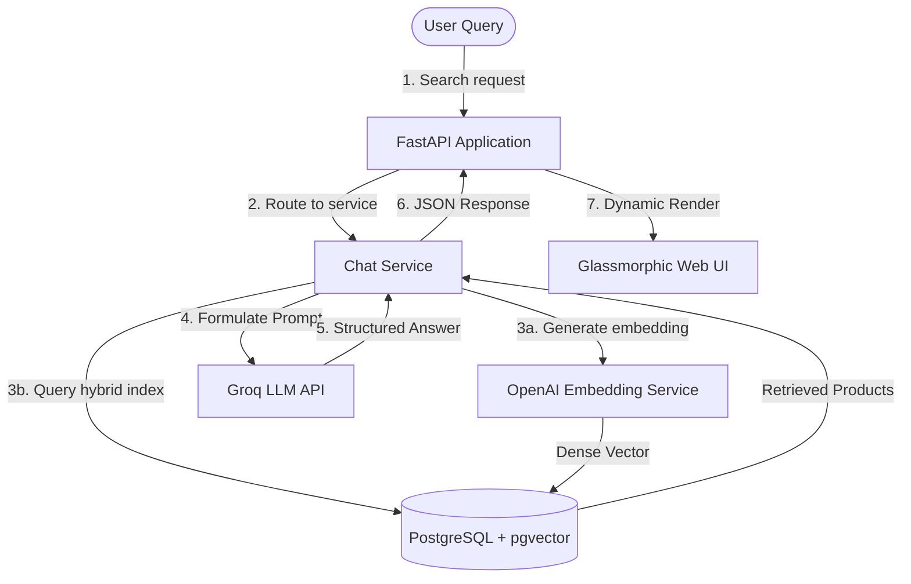

# 🚀 Hybrid Search for RAG with Postgres, pgvector & Groq

A high-performance Retrieval-Augmented Generation (RAG) system utilizing **Postgres** and **pgvector** as a hybrid search engine (vector + semantic keyword search), powered by **FastAPI** and **Groq LLM** with function-calling.

---


---

## 📖 Overview

This repository demonstrates how to build a production-grade, hybrid search database retrieval mechanism for RAG applications. By combining dense vector embeddings with traditional relational keyword matching, the application retrieves relevant product context and feeds it to Groq's Large Language Models to generate accurate, context-aware responses.

### 🌐 System Architecture & RAG Flow



---

## 🛠️ Technology Stack

Our search engine and API are built using modern, reliable technologies:

| Category | Technology | Description |
| :--- | :--- | :--- |
| **Backend Framework** |  | Lightweight, asynchronous, high-performance web framework. |
| **Database & Vector Store** |   | PostgreSQL database extension for storing and querying vector embeddings. |
| **Language Model** |  | Lightning-fast inference engine for function-calling and RAG context generation. |
| **Embeddings** |  | For generating high-quality dense vector representations of items. |
| **ORM** |  | Object Relational Mapper for clean, Pythonic database operations. |
| **Language** |  | Version 3.8+ for core application logic. |

---

## ✨ Features

- **Hybrid Search Retrieval**: Merges dense vector cosine similarity (`pgvector`) and standard relational filtering for superior accuracy.
- **Asynchronous LLM Integration**: Fast API responses with Groq's high-speed API.
- **Function Calling**: Empowers the LLM to query the database dynamically.
- **Interactive UI**: A modern, glassmorphic chat interface to search, discover, and recommend products.
- **Auto-embedded Ingestion**: Data loading scripts automatically embed products via OpenAI's API.

---

## 🚀 Getting Started

Follow these steps to set up the project on your local machine.

### 📋 Prerequisites

- **Python**: `3.8` or higher
- **PostgreSQL**: With `pgvector` extension installed.

---

### 📦 Installation & Setup

> [!NOTE]
> Ensure you have your API keys ready for OpenAI and Groq before configuring.

#### 1. Clone & Set Up Environment
```bash
# Clone the repository
git clone https://github.com/placeholder-username/Hybrid-Search-For-Rag.git
cd Hybrid-Search-For-Rag

# Create and activate a virtual environment
python -m venv venv
# On Windows:
venv\Scripts\activate
# On macOS/Linux:
source venv/bin/activate

# Install dependencies
pip install -r requirements.txt
```

#### 2. Configure Database & Extensions
Ensure your PostgreSQL server is running, then run:
```sql
-- Connect to PostgreSQL shell
psql -U postgres

-- Create the database
CREATE DATABASE rag_example_schema;

-- Connect to the database and enable the pgvector extension
\c rag_example_schema
CREATE EXTENSION IF NOT EXISTS vector;
\q
```

#### 3. Define Environment Variables
Create a `.env` file in the root directory and populate it with your keys:
```env
OPENAI_API_KEY=your_openai_api_key
GROQ_API_KEY=your_groq_api_key
DATABASE_NAME=rag_example_schema
DATABASE_USER=your_database_user
DATABASE_PASSWORD=your_database_password
DATABASE_URL=localhost
DATABASE_PORT=5432
```

---

### 📥 Loading Sample Data

> [!IMPORTANT]
> To load data efficiently, we temporarily disable the HNSW index constraint, load the data, and then re-enable the index.

1. **Temporarily comment out the index** in `models/product.py` (lines 89-96):
   ```python
   # index_ada002 = Index(
   #     "hnsw_index_for_innerproduct_product_embedding_ada002",
   #     Product.embedding,
   #     postgresql_using="hnsw",
   #     postgresql_with={"m": 16, "ef_construction": 64},
   #     postgresql_ops={"embedding_ada002": "vector_ip_ops"},
   # )
   ```
2. **Run the ingestion script**:
   ```bash
   python scripts/load_data.py
   ```
3. **Re-enable the index** in `models/product.py` by uncommenting the lines:
   ```python
   index_ada002 = Index(
       "hnsw_index_for_innerproduct_product_embedding_ada002",
       Product.embedding,
       postgresql_using="hnsw",
       postgresql_with={"m": 16, "ef_construction": 64},
       postgresql_ops={"embedding_ada002": "vector_ip_ops"},
   )
   ```

---

### 💻 Running the Application

Start the FastAPI web server:
```bash
uvicorn app:app --reload
```
Once running, open your browser and navigate to:
👉 **[http://localhost:8000](http://localhost:8000)**

---

## 🤝 Contributing

Contributions make the open-source community an amazing place to learn, inspire, and create. Any contributions you make are **greatly appreciated**.

1. Fork the Project
2. Create your Feature Branch (`git checkout -b feature/AmazingFeature`)
3. Commit your Changes (`git commit -m 'Add some AmazingFeature'`)
4. Push to the Branch (`git push origin feature/AmazingFeature`)
5. Open a Pull Request
